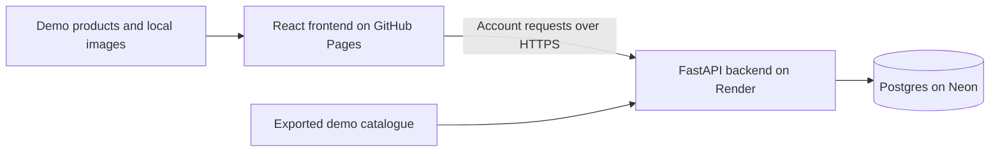

# PriceWise Beauty

PriceWise Beauty helps users discover beauty products, compare sample retailer prices, find affordable alternatives and save their shopping preferences.

The website has two connected parts: a **React frontend** for browsing and a **Python backend** for accounts and saved data.

**[Live website](https://master2007-star.github.io/beauty/)** · **[Live API docs](https://pricewise-beauty-api.onrender.com/docs)** · **[Download source code](https://github.com/master2007-star/beauty/archive/refs/heads/main.zip)**

> Product prices, discounts and reviews are demo data. Signup, login and saved account data use a real backend and database.

## Contents

- [Features](#features)
- [Using the website](#using-the-website)
- [Demo data and real account data](#demo-data-and-real-account-data)
- [How the project works](#how-the-project-works)
- [Technology](#technology)
- [Source structure](#source-structure)
- [Local setup](#local-setup)
- [Environment settings](#environment-settings)
- [Changing products and images](#changing-products-and-images)
- [API reference](#api-reference)
- [Testing and verification](#testing-and-verification)
- [Deployment](#deployment)
- [Troubleshooting](#troubleshooting)
- [Current limitations](#current-limitations)

## Features

| Feature | What users can do |
| --- | --- |
| Product discovery | Browse 23 beauty products through 19 category tiles. |
| Search and filters | Search names, brands or ingredients; filter by category, brand, skin type and budget. |
| Sorting | Sort by price, name, rating or featured/deal order. |
| Retailer comparison | Compare demo offers across Nykaa, Tira, Purplle, Amazon India and Myntra. |
| Product links | Visit a product page, or search the retailer when an exact listing is unavailable. |
| Affordable alternatives | Explore curated alternatives and their sample savings. |
| Product guidance | Read ingredients, usage instructions, precautions and demo reviews. |
| Accounts | Create an account, sign in and sign out. |
| Watchlist | Save or remove favourite products; signed-in users can retrieve them on another device. |
| Price targets and alerts | Save target prices and in-app demo notifications. |
| Beauty profile | Save skin type, concerns, preferred brands, budget and makeup preferences. |
| AM/PM routines | View starter routines, add steps, reorder steps and remove them. |

## Using the website

1. Open the [live website](https://master2007-star.github.io/beauty/).
2. Choose a category or use the search bar and filters.
3. Open a product to view its ingredients, usage guidance and retailer comparison.
4. Use the heart button to save a product.
5. Sign up or sign in to keep saved products and preferences in your account.
6. Open Watchlist to manage favourite products and price targets.
7. Open your profile and Routines to save a beauty profile and arrange AM/PM steps.
8. Open the retailer link to confirm the actual price, stock, size, shade and delivery before buying.

Public pages: home, product details and the guest watchlist. Profile and saved routines require sign-in.

## Demo data and real account data

| Information | Where it comes from |
| --- | --- |
| Product catalogue, prices, discounts and reviews | Curated demo files in this repository. |
| Retailer links | Maintained product-page links, with product search as a fallback. |
| Product/category photographs | Local image assets; source information is recorded alongside them. |
| Signup and login | The FastAPI account backend. |
| Signed-in favourites, profile and routines | The account database. |
| Signed-in targets and notification records | Account-specific database storage. |
| Guest favourites, targets and notifications | Local storage in that browser. |

Signing in merges guest favourites into the account. Guest price-target records are separate from signed-in target records.

The project uses **SQLite for local development** and **Postgres on Neon for the deployed account backend**. Accounts are kept separate: protected API operations use the identity from the signed session.

There is no live price feed, SerpApi integration or automated retailer scraping. A saved target does not turn the demo catalogue into a live market-price monitor.

## How the project works



1. The frontend reads its catalogue and images from local source files.
2. Signup, login, watchlist, profile, routine and target requests go to the backend.
3. The backend checks the session before accessing account data.
4. The backend reads or writes the current user's records in the database.
5. The browser displays the result and keeps an account-specific local cache.

At backend startup, the application initializes its schema and imports the exported demo catalogue. Catalogue updates use stable product IDs so saved favourites remain connected to their products.

## Technology

| Part | Technology | Purpose |
| --- | --- | --- |
| Frontend | React, TypeScript, Vite | Pages, components and development/build tools. |
| Styling | Tailwind CSS | Layout, colours and responsive styling. |
| Navigation | React Router | Home, product, watchlist, profile and routine routes. |
| Motion/icons | Framer Motion, Lucide | Animations and interface icons. |
| Backend | Python, FastAPI, Uvicorn | Account and product API. |
| Database | SQLite locally; Postgres in production | Demo catalogue and account storage. |
| Postgres driver | Psycopg | Server-side database connections and transactions. |
| Password storage | Salted PBKDF2 hashes | Store a password hash instead of the plain password. |
| Sessions | Signed tokens; secure HTTP-only cookies in production | Identify the signed-in user. |
| Tests | Pytest and repository check scripts | Backend behavior, images and product links. |

Dependency versions are declared in [frontend/package.json](frontend/package.json), [backend/requirements.txt](backend/requirements.txt) and [backend/requirements-dev.txt](backend/requirements-dev.txt).

## Source structure

```text
beauty/
├── backend/
│   ├── src/
│   │   ├── api/              # HTTP routes, request schemas and access checks
│   │   ├── database/         # Connections, models and catalogue loading
│   │   ├── services/         # Account, profile, routine and product logic
│   │   ├── analysis/         # Price comparison calculations
│   │   └── config.py         # Environment settings and data paths
│   ├── data/
│   │   ├── frontend-catalogue.json  # Exported frontend demo products
│   │   ├── schema.sql              # Local SQLite schema
│   │   └── schema-postgres.sql     # Cloud database schema
│   ├── tests/                # Unit, service and API integration tests
│   ├── scripts/              # Database schema generation
│   ├── .env.example          # Backend configuration template
│   ├── requirements.txt      # Runtime dependencies
│   └── requirements-dev.txt  # Runtime + test dependencies
├── frontend/
│   ├── src/
│   │   ├── pages/            # Main website pages
│   │   ├── components/       # Reusable interface components
│   │   ├── context/          # Shared account, catalogue and wishlist state
│   │   ├── hooks/            # Wishlist and price-target behavior
│   │   ├── data/             # Products, categories, alternatives and demo content
│   │   ├── utils/            # API client, product links and route helpers
│   │   └── App.tsx           # Application routes and providers
│   ├── public/images/        # Product/category photographs and source metadata
│   ├── public/404.html       # GitHub Pages product-route recovery
│   ├── scripts/              # Image/link checks and catalogue export
│   ├── .env.example          # Frontend API URL template
│   └── vite.config.ts        # Build settings and /beauty/ deployment base
├── docs/DEPLOYMENT.md         # Additional hosting instructions
├── graphify-out/              # Generated code map; local caches are ignored
├── render.yaml                # Render backend configuration
└── README.md
```

Useful starting points: [frontend routes](frontend/src/App.tsx), [API client](frontend/src/utils/api.ts), [backend routes](backend/src/api/main.py), [saved target/alert API](backend/src/api/shopping.py) and [catalogue loader](backend/src/database/catalogue.py).

## Local setup

### Requirements

- Node.js 24 or newer, with npm.
- Python 3.12 or newer.
- Git.
- Two terminals: one for the backend and one for the frontend.

A cloud database or retailer API key is not required for local development.

### Download the repository

```powershell
git clone https://github.com/master2007-star/beauty.git
cd beauty
```

### Windows PowerShell: backend

From the repository root:

```powershell
cd backend
python -m venv .venv
.\.venv\Scripts\python.exe -m pip install -r requirements-dev.txt
Copy-Item .env.example .env
.\.venv\Scripts\python.exe -m uvicorn src.api.main:app --host 127.0.0.1 --port 8000 --reload
```

These commands create an isolated Python environment, install dependencies, copy the settings template and start the API. They do not require virtual-environment activation.

Copy environment templates only on first setup. If an environment file already exists, edit it instead of overwriting it.

Backend: **http://127.0.0.1:8000** · API docs: **http://127.0.0.1:8000/docs** · Health: **http://127.0.0.1:8000/api/health**

Leave DATABASE_URL blank to use SQLite. The database and demo catalogue are initialized automatically.

### Windows PowerShell: frontend

Open a second terminal at the repository root:

```powershell
cd frontend
npm ci
Copy-Item .env.example .env.local
npm run dev
```

npm ci installs the versions recorded in the lockfile. Vite prints the actual local URL, normally **http://localhost:5173**. If that port is busy, it may use another port.

### macOS/Linux

Backend, from the repository root:

```bash
cd backend
python3 -m venv .venv
.venv/bin/python -m pip install -r requirements-dev.txt
cp .env.example .env
.venv/bin/python -m uvicorn src.api.main:app --host 127.0.0.1 --port 8000 --reload
```

Frontend, in a second terminal:

```bash
cd frontend
npm ci
cp .env.example .env.local
npm run dev
```

### Stop the servers

Press Ctrl+C in each terminal when finished.

## Environment settings

### Backend: backend/.env

| Setting | Local development | Production |
| --- | --- | --- |
| APP_ENV | development | production |
| PRICEWISE_DB_PATH | data/pricewise.db | Used only when DATABASE_URL is blank. |
| DATABASE_URL | Leave blank for SQLite. | Private Postgres connection string. |
| AUTH_SECRET_KEY | Optional locally; a temporary key is generated if blank. | Required: a random secret of at least 32 characters. |
| CORS_ORIGINS | Allowed frontend origins, separated by commas. | Include https://master2007-star.github.io for this deployment. |
| PRICEWISE_ENV_FILE | Optional path to a settings file; otherwise backend/.env is read. | The existing Render service reads /etc/secrets/backend.env. |

Use the same production session secret across deployments. Changing it invalidates existing signed sessions. A blank local secret also changes when the backend restarts.

### Frontend: frontend/.env.local

```dotenv
VITE_API_BASE_URL=http://127.0.0.1:8000
```

For the deployed site, use https://pricewise-beauty-api.onrender.com instead. Restart Vite after changing environment settings; rebuild the published site after changing production settings.

The API URL is public. **Database credentials and AUTH_SECRET_KEY must stay on the backend**, outside frontend environment variables and browser code.

## Changing products and images

| Change | Source file/folder |
| --- | --- |
| Products, quantities, ingredients and demo retailer offers | [frontend/src/data/products.ts](frontend/src/data/products.ts) |
| Category tiles | [frontend/src/data/categories.ts](frontend/src/data/categories.ts) |
| Affordable alternatives | [frontend/src/data/alternatives.ts](frontend/src/data/alternatives.ts) |
| Demo reviews | [frontend/src/data/reviews.ts](frontend/src/data/reviews.ts) |
| Product photographs | frontend/public/images/products/ |
| Category photographs | frontend/public/images/categories/ |

After editing the product catalogue, run this from frontend/:

```powershell
node scripts/export-catalogue.mjs
```

This updates backend/data/frontend-catalogue.json. Restart or redeploy the backend to import the updated catalogue. Rebuild the frontend when publishing website changes.

Keep existing product IDs stable. If you replace an image, update its source metadata and run the image checks. The checks verify file validity, hashes and photograph uniqueness.

Source records: [product photographs](frontend/public/images/products/sources.json), [category photographs](frontend/public/images/categories/sources.json) and [product-link verification](docs/product-link-verification.json).

## API reference

The complete request/response schemas are available in [the live API documentation](https://pricewise-beauty-api.onrender.com/docs).

| Method | Endpoint | Purpose | Sign-in needed |
| --- | --- | --- | --- |
| GET | /api/health | Server/database health and catalogue count. | No |
| GET | /api/products | List/filter backend catalogue products. | No |
| GET | /api/products/{slug_or_id} | Product details. | No |
| POST | /api/auth/register | Create an account. | No |
| POST | /api/auth/login | Sign in and return a session. | No |
| POST | /api/auth/logout | Clear the session cookie. | No; the frontend also clears its token. |
| GET | /api/auth/me | Current account details. | Yes |
| GET, PUT, DELETE | /api/profile | Read, update or reset the beauty profile. | Yes |
| GET, POST | /api/watchlist | Read or add saved products. | Yes |
| DELETE | /api/watchlist/{product_id} | Remove a saved product. | Yes |
| POST | /api/watchlist/sync | Import guest favourites into the account. | Yes |
| GET, POST | /api/routines | List or create routines. | Yes |
| PUT, DELETE | /api/routines/{routine_id} | Update or remove an owned routine. | Yes |
| POST | /api/routines/{routine_id}/items | Add a routine step. | Yes |
| PUT | /api/routines/{routine_id}/reorder | Reorder steps. | Yes |
| DELETE | /api/routines/{routine_id}/items/{item_id} | Remove a step. | Yes |
| GET, PUT | /api/shopping-state | Load or save targets and notification records. | Yes |
| GET | /api/recommendations/personalized | Profile-based catalogue recommendations. | Yes |

Protected endpoints accept a signed bearer token in the Authorization header or a valid session cookie. The frontend manages these requests automatically. Sessions are issued for seven days by default.

The legacy /api/compare/auto and /api/compare/url endpoints do not fetch live prices in this demo configuration.

## Testing and verification

### Backend tests

From backend/ on Windows:

```powershell
.\.venv\Scripts\python.exe -m pytest -q
```

On macOS/Linux:

```bash
.venv/bin/python -m pytest -q
```

Tests cover accounts, invalid login, duplicate registration, private account records, profiles, routines, saved products, price-target persistence, catalogue handling and comparison/service calculations.

### Frontend checks

From frontend/:

```powershell
npm run build
npm run lint
npm run check:images
npm run check:categories
npm run check:links
```

| Command | What it checks |
| --- | --- |
| build | TypeScript and the production bundle. |
| lint | Source-code lint rules. |
| check:images | Product photos exist, have valid hashes and are unique. |
| check:categories | All 19 category photos exist and no photograph is repeated. |
| check:links | Product/retailer URL mappings and safe search fallbacks. |

**Verification snapshot — 25 November 2026:** 179 backend tests passed; the frontend build and image/category/link checks passed. The image checks covered 44 unique product/category assets. Rerun the checks after changes.

## Deployment

### Frontend: GitHub Pages

From frontend/, build in PowerShell:

```powershell
$env:GITHUB_PAGES = 'true'
$env:VITE_API_BASE_URL = 'https://pricewise-beauty-api.onrender.com'
npm ci
npm run build
```

1. Publish the contents of frontend/dist/ to the gh-pages branch.
2. Put index.html at that branch's root, rather than inside a dist folder.
3. Keep a .nojekyll file in the published branch.
4. In GitHub Settings → Pages, select gh-pages and the root folder.
5. Wait for the Pages build to finish, then open the live site.

main contains source code; gh-pages contains generated website files. A source commit alone does not publish a new frontend build.

GITHUB_PAGES sets the Vite asset/router base to /beauty/. The 404.html redirect restores shared product URLs. If the repository name changes, update both the Vite base and the redirect path.

### Backend: Render

Use [render.yaml](render.yaml), or configure a Python web service with:

| Setting | Value |
| --- | --- |
| Repository / branch | master2007-star/beauty / main |
| Root directory | backend |
| Build command | pip install -r requirements.txt |
| Start command | uvicorn src.api.main:app --host 0.0.0.0 --port $PORT |
| Health check | /api/health |

Configure APP_ENV=production, DATABASE_URL, AUTH_SECRET_KEY and CORS_ORIGINS on the server. Deploy the intended main commit from Render, then check /api/health.

Use persistent Postgres storage for account data. The current service uses an isolated Neon branch and the pricewise database schema. SQLite files are suitable for local development, not persistent storage on a replaceable Render service.

See [docs/DEPLOYMENT.md](docs/DEPLOYMENT.md) for the current service settings and verification checklist.

## Troubleshooting

| Problem | What to check |
| --- | --- |
| python is not found | Install Python 3.12+ and enable its PATH option, or use the installed Python launcher. |
| npm is not found | Install Node.js 24+ and reopen the terminal. |
| Backend starts from the wrong folder | Run the Uvicorn command from backend/, where the src package exists. |
| Port 8000 is busy | Stop the other process or choose another backend port, then update VITE_API_BASE_URL. |
| Frontend cannot reach the backend | Check the backend is running and the frontend API URL points to it. Restart Vite after editing settings. |
| Signup/login is slow on the live site | A free Render service may take about a minute to wake after inactivity. Wait for the first request. |
| Browser shows the older site | Use Ctrl+Shift+R after the Pages deployment finishes. |
| Profile/routines ask for sign-in | These pages require an account session. Sign in or sign in again after expiry. |
| Session expires after a backend restart | Keep AUTH_SECRET_KEY stable; a generated local key changes on restart. |
| Cloud sync reports an error | Check the API connection and sign-in state. Local data is not proof that the cloud save succeeded. |
| Backend rejects a deployed frontend origin | Add its exact scheme + hostname to CORS_ORIGINS; do not include a page path such as /beauty/. |
| Shared product link fails on GitHub Pages | Check the /beauty/ base and that 404.html is included in the published branch. |
| Updated catalogue is missing on the backend | Export the catalogue, then restart/redeploy the backend. |
| A link opens retailer search | An exact maintained product listing is unavailable; the search uses the product name and brand. |

## Current limitations

- Prices, discounts, reviews and deal examples are curated demo content.
- Stock, checkout delivery fees and retailer promotions must be confirmed on the retailer website.
- Photographs may show similar packaging; confirm the exact size/shade before buying.
- Targets and notifications are an in-app demo feature; no background market monitoring, email or SMS delivery is configured.
- Email verification and a password-reset workflow are not implemented.
- Guest records stay in one browser; clearing browser storage can remove them.
- Cloud saves require a working API connection. Targets and notification storage support up to 100 targets and 200 notification records per account.
- Free hosting has wake-up delays and usage limits.

Environment files, session secrets, database URLs, local databases, virtual environments and generated build/cache folders are excluded from source control. Image source records and the generated code map remain in the repository.
